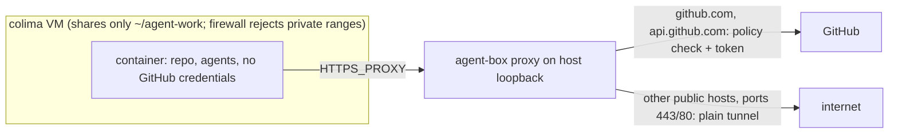

# agent-box

`agent-box` opens a shell for an untrusted GitHub repo inside a colima VM,
with omp, Claude Code, and agy installed. The session can read the repo and
write only what its URL names:

| URL | The session may write |
|---|---|
| `https://github.com/OWNER/REPO` | the whole repo |
| `https://github.com/OWNER/REPO/tree/BRANCH` | pushes to `BRANCH` (not deleting it); opening a PR from it |
| `https://github.com/OWNER/REPO/pull/N`, head branch in the same repo | pushes to the PR's branch; comments, reviews, and edits on PR #N; never merging |
| `https://github.com/OWNER/REPO/pull/N`, head branch in a fork | comments and reviews on PR #N only |

No session may change workflows, repo settings, or secrets.

## One-time setup

```bash
nix run .#agent-box -- setup
```

This opens your browser to create a private GitHub App (`agent-box-XXXXXX`),
stores its private key with sops in
`~/src/home/secrets/agent-box-github-app.yaml`, then opens the app's install
page. Install it on the repos agents may use. A private app can only be
installed on the account that owns it; use `setup --org ORG` for an
organization's repos.

## Use

```bash
nix run .#agent-box -- run https://github.com/OWNER/REPO/pull/42
nix run .#agent-box -- run https://github.com/OWNER/REPO/tree/fix \
  --pkg lean4 --pkg elan --env ANTHROPIC_API_KEY
nix run .#agent-box -- run OWNER/REPO -- omp
```

- `--pkg NAME` adds a nixpkgs package (from this flake's locked nixpkgs);
  `--pkg FLAKE#ATTR` adds any flake installable. Repeatable.
- `--env NAME` copies a host environment variable, such as an agent API key,
  into the session. Prefer a key used only for agent-box, with a spending cap.
- Arguments after `--` run in the repo instead of an interactive shell.

The repo is cloned into `<workspace>/repo` on the first run and reused after
that; agent logins made inside a session persist in `<workspace>/home`. Each
repo, branch, and PR gets its own workspace (see [Files](#files)).

## How it is isolated



- **VM.** The `agent-box` colima profile shares only `~/agent-work` with the
  host. Each run checks the VM's mounts and refuses to start if it sees any
  other host directory. A container escape reaches the work root and nothing
  else in your home directory.
- **Credentials.** The container never holds a GitHub token. The proxy mints
  a GitHub App installation token limited to the one repo and the permissions
  in `src/github.rs`, renews it before its one-hour expiry, and adds it to
  requests that pass the policy.
- **Branch and PR limits.** GitHub tokens cannot be limited to a branch, so
  the proxy decrypts traffic to `github.com` and `api.github.com` with a
  per-session CA the container trusts. It reads the ref updates at the start
  of each push and the body of each GraphQL request, and forwards only what
  the session's URL allows (`src/policy.rs`). Denied requests get a 403 that
  explains why.
- **Store.** Packages are built in a separate container that runs no repo
  code. Sessions mount the Nix store read-only, so one repo cannot plant
  binaries for the next.
- **Network.** A firewall in the VM rejects connections from containers to
  private, loopback, link-local, and CGNAT addresses, so the box cannot reach
  services on your Mac or LAN; only the session's proxy port on the host is
  open. The proxy tunnels only to public addresses on ports 443 and 80, and
  connects to the address it checked. Anything that ignores `HTTPS_PROXY`
  reaches GitHub anonymously.
- **Session files.** The proxy CA and the startup script live outside the
  workspace and are mounted read-only, so code from one run cannot plant a
  symlink that makes the next run overwrite a host file.

**Remaining risk: CI.** A session that can push runs the repo's CI
workflows on code it wrote, and those workflows can read whatever secrets
the repo gives them. The proxy cannot see this. agent-box prints a warning
for such sessions. On repos with sensitive secrets, keep the secrets in
environments that require a reviewer's approval.

Reads cannot be narrower than the repo: git objects are shared across
branches.

## Files

| Path | Contents |
|---|---|
| `~/agent-work/<owner>/<repo>/<scope>/` | the workspace mounted at `/work`; `scope` is `repo`, `pr-N`, or `branch-NAME-HASH` |
| `~/agent-work/.agent-box/sessions/…` | the session CA and startup script, mounted read-only |
| `~/agent-work/.agent-box/logs/<owner>/<repo>/<scope>.log` | every proxied GitHub request and every denial |
| `~/agent-work/.agent-box/flakes/` | copies of this flake the VM builds agents from |
| Docker volume `agent-box-nix` | the shared Nix store |

Stop the VM with `colima stop --profile agent-box`. To start over, run
`colima delete --profile agent-box`.
